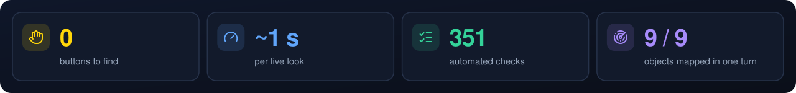
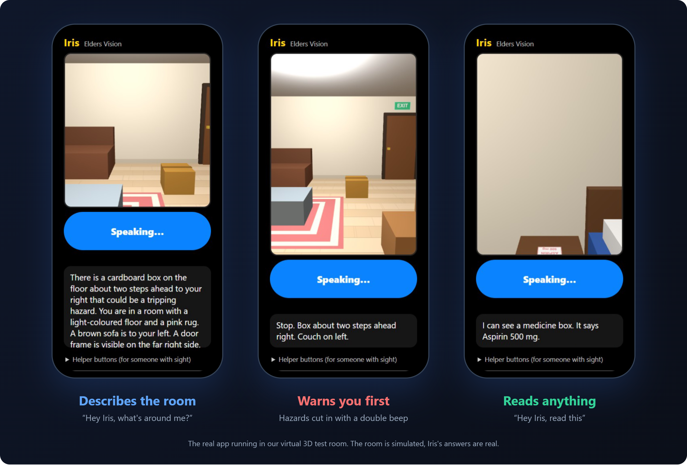
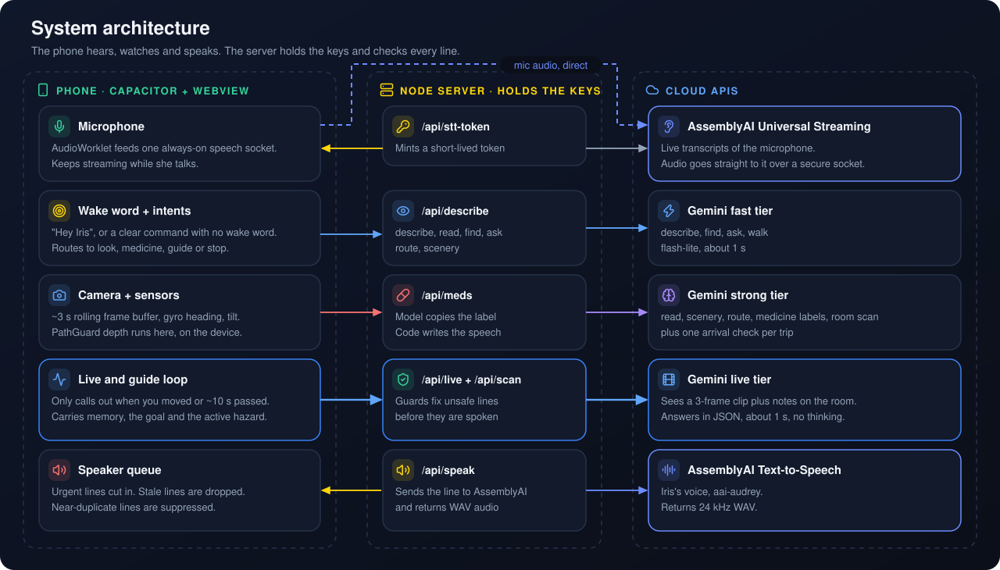
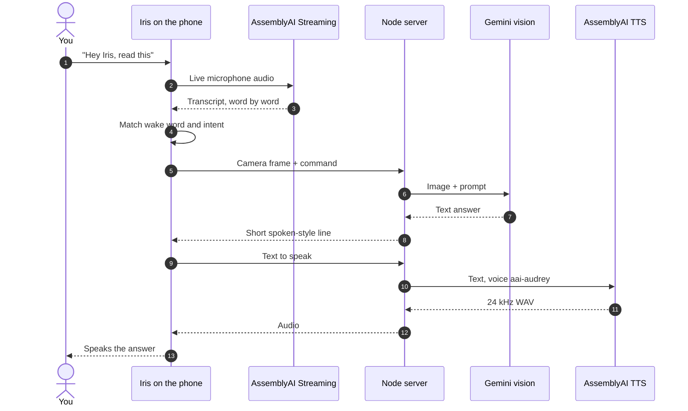
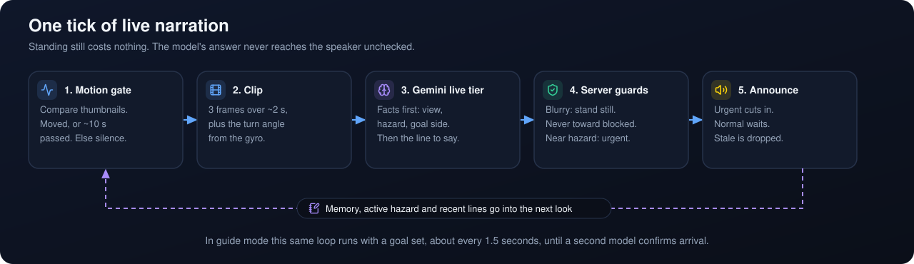
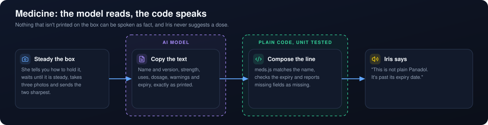
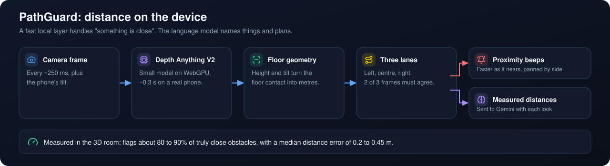
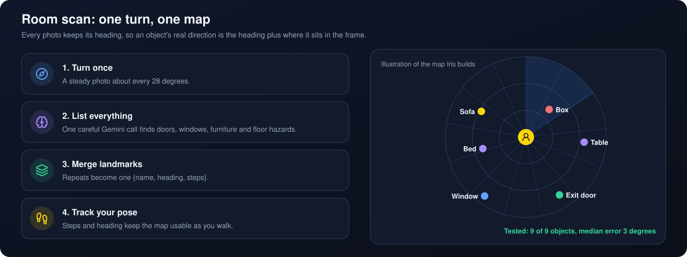
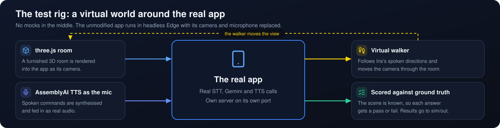

<div align="center">



<br><br>

<a href="#-how-it-works"></a>
<a href="#-how-it-works"></a>
<a href="#-how-it-works"></a>
<br>


<br><br>

**A voice-only Android app for blind, low-vision and older people.**<br>
No buttons, no menus, nothing to read. It opens, starts looking, and tells you what's around you.

<sub> Built for the AssemblyAI hackathon</sub>

<br>

[Why](#-why-we-built-it) ·
[Features](#-what-iris-can-do) ·
[How it works](#-how-it-works) ·
[Safety by design](#-safety-by-design) ·
[Testing](#-tested-in-a-virtual-world) ·
[Quick start](#-quick-start) ·
[Native app](#-native-android-app)

<br>



<br><br>



</div>

##  Why we built it

Apps made for people who can't see well still start with a button they have to find. That's the wrong starting point, so we removed it.

Iris has no start screen. The app opens by itself, starts the camera and microphone, and is live straight away. If you close your eyes and walk around a room, she stays with you the whole way:

| Iris | What that means |
|---|---|
|  **She's live** | She describes where you are once, then narrates as you move |
|  **She warns you first** | Hazards come with a double beep and cut in over whatever she's saying |
|  **She knows when to be quiet** | Standing still means silence, because nothing has changed |
|  **She remembers** | Running notes on the room mean she can guide you around a space she has already seen |
|  **She listens** | Say "Hey Iris" for anything else, or just talk over her |

##  What Iris can do

| | Say | Iris |
|---|---|---|
|  | *"Hey Iris, what's around me?"* | Describes the whole scene, hazards first |
|  | *"Read this"* | Reads signs, labels and screens |
|  | *"Help me find Panadol"* | Reads medicine boxes: exact name, strength, expiry date and printed warnings |
|  | *"Find my keys"* | Says where it is and which way to turn |
|  | *"Is it safe to walk?"* | Checks the next few steps |
|  | *"Scan the room"* | You turn once, and she builds a map of what's where |
|  | *"Guide me to the door"* | Briefs the route, then walks you through it |
|  | *"Paint me a picture"* | Describes a view in layers: mountains, the sea, a skyline |
|  | *"What colour is the sofa?"* | Answers questions about what the camera sees |
|  | *"Stop"*, *"resume"*, *"repeat"*, *"help"* | Hands-free control, and you can interrupt her at any time |

> [!TIP]
> Clear commands work without the wake word: *"I want to go to that door"*, *"find my keys"*, *"stop"*. After an answer she keeps listening for about 6 seconds, so follow-ups need no "Hey Iris".

##  How it works



### A command, start to finish



### The live loop

This is what makes Iris a companion instead of a photo describer. It runs continuously, and it doesn't wait to be asked.



### Three Gemini tiers

Each job uses the model that fits it. Live narration needs speed, and reading small print needs accuracy.

| Tier | Used for | Default model | Why |
|---|---|---|---|
|  **Live** | Continuous narration and guiding | `gemini-3.5-flash-lite` | About 1 s, steadier than the alternatives, no thinking step |
|  **Fast** | Describe, find, ask | `gemini-3.1-flash-lite` | Cheap and quick for one-shot commands |
|  **Strong** | Medicine labels, room scan, arrival check | `gemini-3.5-flash` | Accuracy matters more than a second of waiting |

##  Safety by design

When someone can't check an answer with their own eyes, a confident wrong answer is dangerous. So the riskiest paths don't depend on the model getting it right.

### Medicine labels are never guessed



Panadol and Panadol Extra stay different medicines. A strength that's cut off is never read out, a half-hidden name is only ever "might be", and a missing field is reported as missing. See [`meds.js`](meds.js).

### Obstacles are measured on the device



### Guiding starts with a map



### And the rest

- **Guards sit between the model and the speaker.** The server fixes unsafe lines before they're spoken. If the view is blurry she says to stand still, and she never sends you toward a side marked as blocked.
- **The API keys stay off the phone.** The Android shell loads its UI from the server, which holds the keys and mints short-lived streaming tokens.
- **A warning can't be talked over.** Your voice interrupts normal speech, but a safety warning always finishes.

##  Design decisions

| Decision | Why |
|---|---|
| **Voice is the only interface** | The first draft had buttons, and the people it's for can't use them. So the app now starts by itself and runs on a wake word. |
| **Short clips, not single photos** | Three frames over two seconds show whether you're walking toward something, turning or stopped. A single photo can't. |
| **AssemblyAI for both hearing and speaking** | One voice platform handles the full loop. A single long streaming session stays open, even while she talks, so "stop" always works. |
| **No Gemini Live API on the main app** | We tested it. It answers only in audio, stayed silent when the scene changed and invented objects. Clips plus memory gave better results, with AssemblyAI as the voice. |
| **Facts before wording** | The live model fills in structured facts first (view, hazard, goal side), then writes the line. That gives the server something it can check. |
| **Local depth, cloud language** | Research on this problem agrees: a fast local layer should handle "something is close", and the language model should name things and plan. |
| **Wake-word matching is fuzzy** | Speech models hear "Iris" as "Irish" or "Eris", so the matcher accepts those and is unit-tested. |

##  Tested in a virtual world

You can't ask a tester to walk into furniture, so we built a world where it's safe to fail.



| Suite | Covers | Result |
|---|---|---|
| `test/intents.test.js` | Wake word and command parsing | 270 checks passing |
| `test/meds.test.js` | Medicine matching and wording | 56 checks passing |
| `test/roommap.test.js` | Landmark map | 17 checks passing |
| `test/pathsense.test.js` | Floor geometry | 8 checks passing |
| `npm run sim` | Virtual-world scenarios, end to end | 10 of 11 passing in the last full run |

```bash
node test/intents.test.js   # also meds, pathsense and roommap
npm run sim                 # full virtual-world run, about 15 minutes
npm run sim -- read find    # only some scenarios
```

##  Quick start

**You'll need:** Node 20.6 or newer, a [Gemini API key](https://aistudio.google.com/apikey) and an [AssemblyAI API key](https://www.assemblyai.com/dashboard).

```bash
git clone https://github.com/shahwaizse/elders-vision.git
cd elders-vision
npm install
cp .env.example .env        # add your keys
npm start                   # http://localhost:3000
```

It also runs in a desktop browser: tap once to start. Use `npm run demo` for a stronger Gemini model on one-shot commands. Live narration stays on the fast model either way.

<details>
<summary><b>Install on an Android phone</b></summary>

<br>

You'll need JDK 21, Android SDK 36, and wireless debugging turned on.

```bash
adb pair <ip:port> <code>
adb connect <ip:connect-port>
adb reverse tcp:3000 tcp:3000
npx cap sync android
cd android && ./gradlew assembleDebug
adb install -r app/build/outputs/apk/debug/app-debug.apk
```

Allow the camera and microphone on first install, which a helper can do once. After that the app starts by itself. Server and UI changes need no rebuild, so just reopen it.

To run without a PC, deploy the server to an https host and build with:

```bash
APP_SERVER_URL=https://your-host npx cap sync android
```

</details>

<details>
<summary><b>Configuration</b></summary>

<br>

Set these in `.env`.

| Variable | Default | Notes |
|---|---|---|
| `GEMINI_API_KEY` | | Required |
| `ASSEMBLYAI_API_KEY` | | Required |
| `GEMINI_MODEL` | `gemini-3.1-flash-lite` | Fast tier |
| `GEMINI_MODEL_LIVE` | `gemini-3.5-flash-lite` | Live tier, set in `.env.example` |
| `GEMINI_MODEL_VERIFY` | `gemini-3.5-flash` | Arrival check |
| `GEMINI_MODEL_DEMO` | `gemini-3.5-flash` | One-shot commands under `npm run demo` |
| `TTS_VOICE` | `aai-audrey` | Also `aai-peter`, `aai-gunnar`, `aai-carrie`, `aai-nancy`, `aai-sara`, `aai-steven` |
| `PORT` | `3000` | |

The AssemblyAI free tier allows 5 new streaming sessions per minute. The app holds one long session and uses a rolling-window guard with backoff, so reconnects stay under that limit.

</details>

##  Native Android app

[`native-android/`](native-android) is a separate, fully native version that runs with no server.

| | Capacitor app (root) | Native app (`native-android/`) |
|---|---|---|
| **UI** | Web UI in a thin Android shell | Kotlin and Jetpack Compose |
| **Needs a server** | Yes | No |
| **Vision** | Gemini clips plus memory | Gemini Live API |
| **Voice** | AssemblyAI STT and TTS | AssemblyAI STT and TTS, reading Gemini Live's transcript aloud |
| **On-device models** | Depth Anything V2 on WebGPU | MiDaS depth and EfficientDet detection on LiteRT and MediaPipe |
| **API keys** | Stay on the server | Compiled into the APK |

The native app also has a step counter, recorded routes and voice-triggered screen recording. Room scan, path guidance, spoken stop warnings and proximity beeps are built but turned off by default, with the flags at the top of `Config.kt`.

Create `native-android/local.properties`, then run `./gradlew assembleDebug` from that folder:

```properties
sdk.dir=/path/to/android/sdk
gemini.apiKey=your-gemini-key
assemblyai.apiKey=your-assemblyai-key
```

> [!WARNING]
> This version compiles your keys into the APK. Use it for development only, and don't distribute a build.

##  Tech stack

| | Technology | Role |
|---|---|---|
|  | **AssemblyAI** | Universal Streaming for hearing, Text-to-Speech for Iris's voice |
|  | **Gemini** | Vision, reasoning and room memory |
|  | **Node.js + Express** | Keys, prompts, safety guards |
|  | **Capacitor** | Android shell |
|  | **Kotlin + Jetpack Compose** | Native app |
|  | **Depth Anything, MiDaS, MediaPipe** | On-device depth and object detection |
|  | **three.js + Playwright** | Virtual test world |

##  Project layout

```text
elders-vision/
├── server.js             API keys, Gemini prompts, safety guards, TTS and STT tokens
├── meds.js               Medicine logic: what Iris may say from a label
├── public/
│   ├── app.js            Voice loop, camera, live mode, speaker queue
│   ├── intents.js        Wake word and command parsing
│   ├── guard.js          PathGuard on-device depth and beeps
│   ├── pathsense.js      Floor geometry and lane distances
│   ├── roomscan.js       Room scan capture
│   └── roommap.js        Landmark map and dead reckoning
├── android/              Capacitor Android shell
├── native-android/       Standalone Kotlin app
├── sim/                  3D test world and scenarios
├── test/                 Unit tests
└── docs/                 Technical notes, diagrams and assets
```

##  Learn more

- [Technical notes](docs/TECHNICAL.md): full behaviour, measurements and known limits
- [Architecture page](docs/architecture.html): the original system diagrams

##  Safety notice

> [!CAUTION]
> Iris is an aid, not a replacement for a cane, a guide dog or another person. On-device depth misses some obstacles, a chest-height camera can't see low objects right at your feet, and guided walking is still experimental. Don't rely on it where a mistake could hurt someone.

<div align="center">
<br>

**See it. Hear it. Live it.**

</div>
